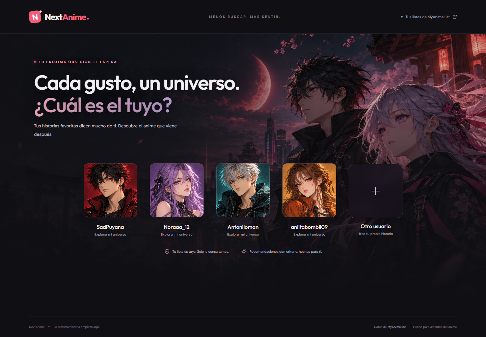
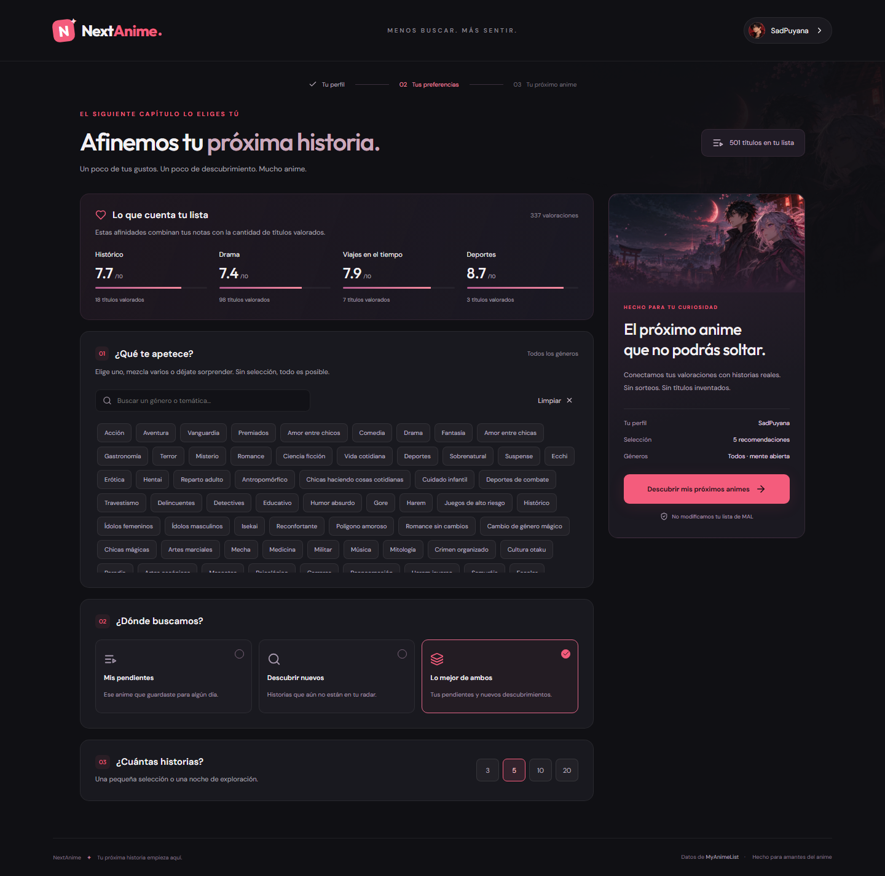
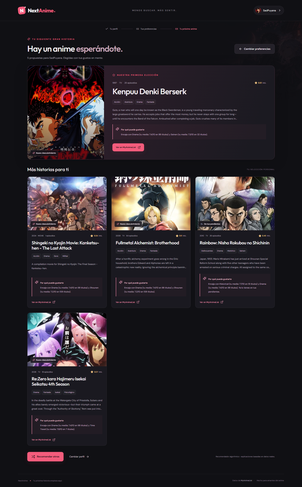

# NextAnime 3.2

Tu próxima historia empieza aquí. Una aplicación de recomendaciones personales basada en tus listas **públicas** de MyAnimeList, con interfaz en español, arte anime original y portadas reales.

- [Abrir NextAnime](https://carlospuyana.github.io/NextAnime-/)
- [Repositorio](https://github.com/CarlosPuyana/NextAnime-)
- [Estado de la API](https://nextanime-server.up.railway.app/api/health)

## Cómo usarlo

1. Elige SadPuyana, Noraaa_12, Antoniioman, aniitabombii09 o introduce otro nombre de MAL.
2. Consulta tus afinidades, elige géneros, origen y 3, 5, 10 o 20 propuestas. **Sin géneros seleccionados se incluyen todos**; varios se combinan con OR.
3. Pulsa **Descubrir mis próximos animes**. Revisa portadas, datos, explicación y enlace real a MAL.
4. **Recomendar otros** conserva tus filtros y evita repetir títulos durante la sesión. Puedes volver a preferencias o cambiar de perfil.

Las recomendaciones clásicas no requieren contraseñas ni OAuth, y no se modifica ninguna lista. Solo se recuerda localmente el último nombre utilizado. El botón **Iniciar sesión** da acceso a la única cuenta administradora para **IA experimental — Groq**, restringida a los cuatro perfiles predefinidos. Se conserva la sesión firmada de cuatro horas. La primera versión con Groq devuelve tres propuestas, hasta seis solicitudes diarias por proceso, con consentimiento y fallback clásico. [Integración y comprobación real de Groq](docs/groq.md).

## Capturas





## Funcionalidades

- Paginación completa y deduplicación de los cinco estados MAL.
- Notas personales explícitas 1–10 separadas de la media pública; cero o ausente equivale a sin valorar.
- Afinidades positivas y negativas con suavizado estadístico y confianza según el historial disponible.
- 78 géneros, temáticas y demografías, independientes de cada lista personal.
- Pendientes, nuevos o ambos; exclusión de estados incompatibles, duplicados y títulos de rondas previas.
- Verificación de precuelas disponibles y diversificación de resultados.
- Carga, errores, estados vacíos, foco de teclado, móvil y respeto a movimiento reducido.
- Explicaciones deterministas funcionales; integración generativa opcional y privada en el servidor.

## Arquitectura

El [sistema de perfiles](docs/profile-system.md) centraliza nombres visibles, usernames MAL, textos, paletas y retratos originales. SadPuyana, Nora, Anto y Anita conservan sus usernames reales y personalizan sutilmente preferencias y resultados. Esta identidad visual no cambia las recomendaciones calculadas con datos de MAL.

```text
frontend/       React + TypeScript + Vite + CSS
backend/src/    Express, proveedor MAL, caché, recomendador y capa opcional de IA
shared/         Tipos, taxonomía y etiquetas en español
tests/          Vitest, Supertest y Playwright con fixtures deterministas
scripts/        Recorrido real, capturas y actualización de taxonomía
docs/           Decisiones, fuentes, validación y capturas
.github/        Validación y publicación en Pages
.railway/       Infraestructura del servicio Railway existente
Dockerfile      Imagen del backend sin frontend, .env ni pruebas
```

Más detalles en [arquitectura](docs/architecture.md), [fuentes](docs/data-sources.md) y [validación](docs/validation.md).

## Desarrollo

Node.js 24 recomendado (mínimo 22), con npm moderno:

```sh
npm ci
cp .env.example .env
# Configura MAL_CLIENT_ID en .env.
npm run dev
```

El frontend local es `http://127.0.0.1:5173/NextAnime-/`; Vite reenvía `/api` a la API local en el puerto 3000. `npm run build` compila ambos proyectos y `npm start` inicia la API compilada. Si cambias el puerto local, actualiza también el proxy en Vite.

### Variables

| Variable                                       | Uso                                                                                          |
| ---------------------------------------------- | -------------------------------------------------------------------------------------------- |
| `MAL_CLIENT_ID`                                | Credencial obligatoria de MAL, solo en backend.                                              |
| `CLIENT_ID`                                    | Compatibilidad con la antigua variable de Railway.                                           |
| `PORT`                                         | Puerto de API; Railway lo inyecta.                                                           |
| `CORS_ORIGINS`                                 | Orígenes permitidos separados por comas; incluye `https://carlospuyana.github.io`.           |
| `VITE_API_URL`                                 | URL pública del backend: `https://nextanime-server.up.railway.app`.                          |
| `GEMINI_API_KEY`                               | Clave nueva de Gemini, solo en variables privadas de Railway.                                |
| `GEMINI_ENABLED`                               | `false` en esta publicación: Gemini preparado, desactivado.                                  |
| `GEMINI_MODEL`                                 | Modelo preparado: `gemini-3.1-flash-lite`.                                                   |
| `GEMINI_DEPLOYMENT_REGION`                     | `EEA` para esta web; el nivel gratuito no es aplicable a este despliegue público.            |
| `GEMINI_QUOTA_DB` / `GEMINI_QUOTA_SECRET`      | Almacén persistente y seudonimización necesarios para habilitar llamadas.                    |
| `GEMINI_DAILY_LIMIT` / `GEMINI_MAX_CONCURRENT` | 10 llamadas/día y 1 concurrente por defecto, además de límites por cliente, perfil y tokens. |

Las variables `VITE_` son públicas: nunca deben contener secretos. `.env`, `.local`, `node_modules` e informes de pruebas quedan fuera de Git. La rama `backup/original-2026-11-01` conserva el historial anterior. La credencial incrustada antiguamente sigue en ese historial y ya no aparece en el nuevo código.

## Cómo recomienda

Se recuperan páginas de hasta 1000 entradas hasta agotar la lista. Las afinidades usan únicamente notas explícitas de completados, suavizadas según el volumen de muestras. Los títulos sin nota no expresan rechazo ni aprobación.

El pool externo reúne rankings oficiales por nota y popularidad, una página de títulos menos populares y temporadas actuales y de los dos años anteriores: hasta 800 entradas antes de deduplicar. Las tres fuentes adicionales son opcionales. Se combina con Plan to Watch según el origen. Los filtros y exclusiones son obligatorios antes del ranking.

El motor combina afinidad de géneros, similitud de sinopsis con tokens e IDF, preferencias de formato, nota pública, coincidencia de filtros y penalización de similitud para dar variedad. Los pesos están en `DEFAULT_WEIGHTS`. Comprueba metadatos y precuelas; los candidatos no verificables se omiten con un aviso. `rankingScore` es una señal interna, **no una probabilidad**, y no se presenta como porcentaje.

El modo clásico mantiene ese algoritmo. Groq recibe hasta 12 candidatos ya filtrados, fragmentos de sinopsis y un resumen con hasta cinco favoritos y dos rechazos, sin username ni imágenes. Selecciona los IDs y su orden y redacta dos frases de encaje narrativo por título. Puede vincularlas a un favorito positivo cuyo ID verifica el servidor, que añade su nombre y la nota real. Se comprueban cantidad, IDs, rangos, filtros, referencias y spoilers evidentes; no se presenta esa comprobación como una prueba formal de todas las interpretaciones semánticas del modelo. Ante errores, cuotas o falta de consentimiento/configuración se conserva el resultado clásico y se indica el motor realmente utilizado. Gemini se conserva desactivado como integración compatible.

**Estado 3.2: Groq como proveedor experimental predeterminado**, `GROQ_MODEL=openai/gpt-oss-20b`, `GROQ_ENABLED=true`, `GROQ_TIMEOUT_MS=45000`; `GEMINI_ENABLED=false`. Ambas comprobaciones reales se ejecutaron dentro de Railway: conectividad HTTP 200 en 160 ms y recomendación validada de SadPuyana en 632 ms, con 2.101 tokens de entrada y 187 de salida. Los visitantes mantienen el clásico. Las claves permanecen en variables privadas. Los contadores en memoria se reinician con el proceso; no garantizan seis llamadas totales entre reinicios o réplicas. No se activó facturación ni se crearon servicios de pago.

Consulta [la evaluación comparativa](docs/recommendation-evaluation.md) y [el registro de QA 3.0](docs/gemini-validation.md). No se afirma una mejora de calidad de Gemini sin una evaluación real.

## Validación

```sh
npm run lint
npm run typecheck
npm test
npm run build
npx playwright install chromium
npm run test:e2e
# Con ambos servidores locales activos y MAL configurado:
npm run test:live
```

`test:live` no usa mocks: consulta MAL, comprueba dos rondas, enlaces, portadas, recarga y vista móvil. Para producción configura `APP_URL=https://carlospuyana.github.io/NextAnime-/`. Las pruebas deterministas no acreditan conectividad real y no deben confundirse con este recorrido.

## Despliegue

**Pages:** el workflow compila y valida lint, tipos, Vitest y Playwright antes de publicar **solo `dist/frontend`** desde main. Vite usa `/NextAnime-/`. La navegación por estados evita errores 404 al recargar. Ningún .env o archivo privado se publica como parte del sitio.

**Railway:** se conserva `Server NextAnimeJS → NextAnime- → production` y el dominio existente. Docker compila el backend y mantiene únicamente dependencias de producción. Escucha `0.0.0.0:$PORT`; el healthcheck está en `/api/health`.

La infraestructura está en `.railway/railway.ts`, con variables no administradas por código para conservar secretos fuera de Git. La CLI oficial permite revisar `railway config plan` antes de aplicar. `railway.json` mantiene compatibilidad durante la migración. No se crean servicios duplicados ni planes de pago.

## Límites y siguientes mejoras

- El pool externo es real y acotado, no un índice exhaustivo: géneros raros o muchas rondas pueden dar menos títulos.
- La taxonomía se verificó el 1 de noviembre de 2026. `node scripts/update-genres.mjs` la actualiza desde el catálogo oficial.
- Títulos y sinopsis conservan el idioma de MAL, normalmente inglés o japonés romanizado. Controles y etiquetas están en español.
- Se comprueban las precuelas directas que MAL ofrece; sus relaciones pueden ser incompletas.
- Caché, rate limit y presupuesto de IA son por proceso. Escalar a varias réplicas requeriría coordinación compartida.
- No se persisten historiales personales en una base de datos. Railway puede necesitar un arranque en frío.
- Mejoras futuras: ampliar el catálogo externo, evaluar embeddings opcionales, feedback voluntario y una fuente autorizada de sinopsis españolas.
